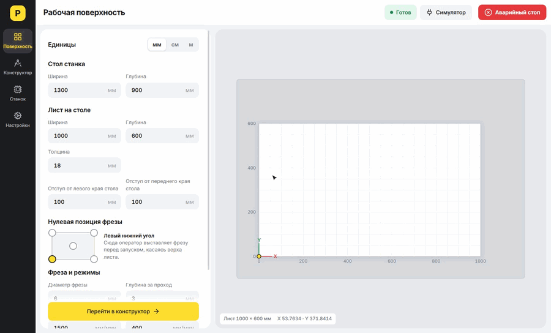
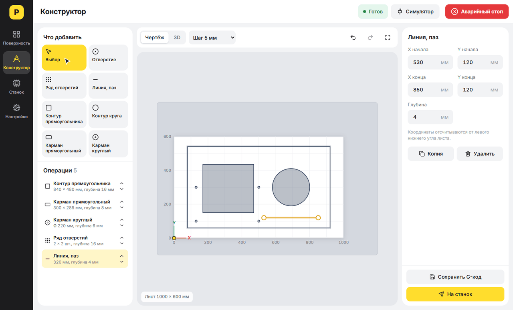
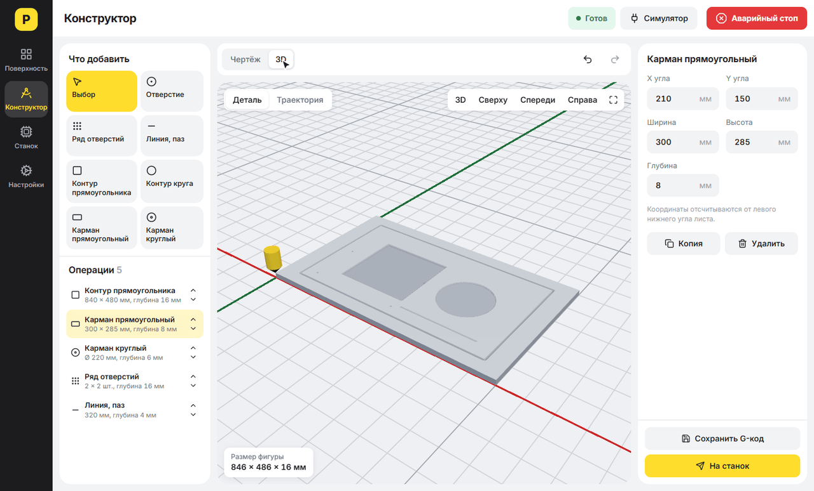
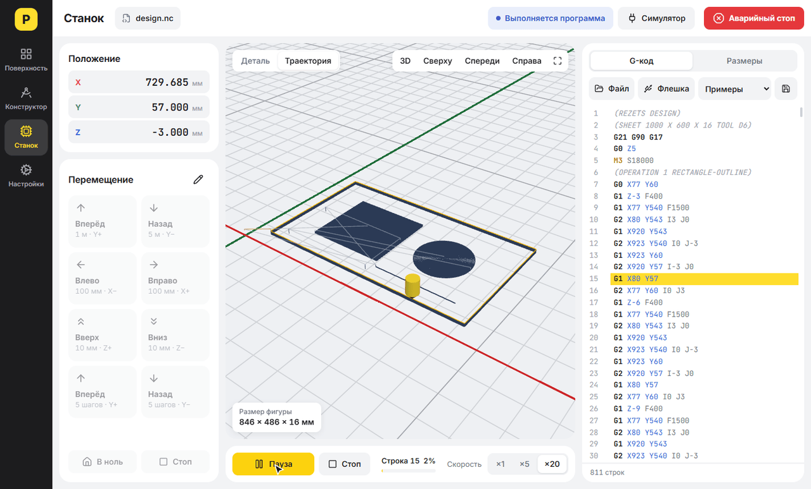

# Резец

Приложение для управления ЧПУ-станками: для Windows и планшетов на Android. Инженер задаёт лист, рисует на нём деталь, видит результат в 3D и отправляет на станок, не написав ни строки G-кода.



**Стек:** TypeScript (strict), Vue 3, Electron, Capacitor, Three.js, CodeMirror 6, Vitest, npm workspaces.

## Как это работает

**1. Рабочая поверхность.** Размеры стола и листа в мм, см или метрах, толщина, положение нуля фрезы, диаметр фрезы и режимы резания.

**2. Конструктор.** Фигуры рисуются прямо на листе: отверстия и ряды отверстий, линии и пазы, контуры, карманы. Положение и размеры меняются мышью или точными значениями в полях. Есть привязка к сетке, отмена действий и порядок резки. Проходы по глубине и смещение на радиус фрезы считаются автоматически. Если рез выходит за лист или глубина больше толщины, программа сообщит об этом и не даст отправить деталь на станок.



**3. 3D-просмотр.** Модель показывает, что останется от заготовки после прохода фрезы.



**4. Станок.** Настраиваемые кнопки перемещения, запуск, пауза, аварийный стоп, текущая строка и прогресс. Здесь же можно работать напрямую с G-кодом: открыть файл, в том числе с флешки, или написать программу вручную, и растянуть фигуру по любой оси.



## Подключение станка

Отдельный сервер не нужен: каналом владеет само приложение (main-процесс Electron или нативный плагин на Android), а протокол реализован в ядре за интерфейсом `MachineController`.

| Подключение | Контроллеры | Состояние |
| --- | --- | --- |
| USB / COM (RS-232), на планшете через OTG | GRBL, grblHAL, FluidNC | реализовано |
| Ethernet / Wi-Fi (TCP) | grblHAL, FluidNC | реализовано |
| Симулятор | не нужен | реализовано |
| Mach3/4, LinuxCNC, Fanuc, Siemens | | нужен отдельный адаптер |

Драйвер GRBL проверен на эмуляции ответов контроллера, на реальном станке он ещё не запускался. Перед первым запуском проверьте его без фрезы и заготовки. Отчёты о положении ожидаются в миллиметрах (`$13=0`).

> Кнопка «Аварийный стоп» в программе отправляет команду контроллеру и **не заменяет** аппаратную кнопку на станке.

## Архитектура

Проект построен по принципам чистой архитектуры: зависимости направлены внутрь, к домену. Ядро и интерфейс вынесены в отдельные пакеты, а десктоп и планшет отличаются только тонкими адаптерами устройства.

```
packages/core            Ядро: только TypeScript
  src/domain             G-код, траектория, рельеф, операции конструктора, правила
  src/application        Сценарии и порты
  src/adapters           Драйвер GRBL и симулятор станка
  tests                  Тесты ядра

packages/ui              Общий интерфейс
  src/createAppContext.ts  Composition root интерфейса
  src/platform.ts          Что интерфейс требует от устройства
  src/viewport             3D-сцена на Three.js, не зависит от Vue
  src/presentation         Модели представления, тексты и компоненты Vue

apps/desktop             Windows: Electron
  src/main               Main-процесс: файлы, флешка, COM и TCP, хранение данных
  src/preload            Типизированный мост между процессами
  src/shared             Контракт IPC
  src/renderer/src       Адаптеры устройства поверх моста

apps/tablet              Android: Capacitor
  src                    Адаптеры устройства: хранение, файлы, связь со станком
  android                Нативная часть: плагин USB и TCP, фоновая служба
```

Импорты идут через алиасы: `@core/*`, `@ui/*`, `@shared/*`.

Несколько решений из кода:

- **Проект, а не G-код, является источником истины.** Конструктор хранит поверхность и список операций, а G-код собирается из них заново: `domain/design/designGenerator.ts`.
- **Эллипс нельзя записать через G2/G3.** При неравном растяжении дуга заменяется отрезками G1, при равномерном остаётся дугой с пересчитанным центром: `domain/gcode/generator.ts`.
- **В домене нет текстов интерфейса.** Он отдаёт коды, а переводит их слой представления: `packages/ui/src/presentation/messages.ts`.
- **Траектория хранится в типизированных массивах**, чтобы программы на миллионы отрезков не перегружали сборщик мусора: `domain/toolpath/toolpath.ts`.
- **Renderer не работает с путями файлов.** Запись возможна только в файл, выбранный оператором в системном окне: `apps/desktop/src/shared/desktopBridge.ts`.

## Запуск

Нужен Node.js 22 или новее.

```bash
npm install
npm run dev
```

Если бинарник Electron не скачался при установке:

```bash
node node_modules/electron/install.js
```

| Команда | Что делает |
| --- | --- |
| `npm run dev` | запуск с горячей перезагрузкой |
| `npm run build` | production-сборка |
| `npm run dist` | установщик для Windows |
| `npm run check` | типы, линтер и тесты |
| `npm run dev:tablet` | планшетный интерфейс в браузере, без USB |
| `npm run apk` | отладочный APK для планшета |
| `npm run apk:release` | подписанный APK для установки |

Для сборки APK нужны JDK 21 и Android SDK (переменные `JAVA_HOME` и `ANDROID_HOME`). Готовые файлы лежат в `apps/tablet/android/app/build/outputs/apk/`.

Release-сборка подписывается ключом из `apps/tablet/android/keystore.properties`; ни ключ, ни этот файл в репозиторий не попадают:

```properties
storeFile=rezets-release.jks
storePassword=...
keyAlias=rezets
keyPassword=...
```

## Ограничения

- На планшете приложение должно оставаться на экране, пока работает программа: система может притормозить его в фоне, а контроллер получает программу небольшими порциями. Подключение к станку не даёт экрану гаснуть.

- Проект хранится автоматически в одном экземпляре; сохранение нескольких проектов в файлы пока не сделано.
- 3D-просмотр считает цилиндрическую фрезу с плоским торцом. На большом листе сетка модели грубее, и мелкие отверстия выглядят менее точно.
- Поддерживаются оси X, Y, Z. О поворотных осях A, B, C программа предупреждает.
- Коррекция на радиус (G41, G42) и смещения нуля (G54–G59) передаются на станок, но в предпросмотре не учитываются.
